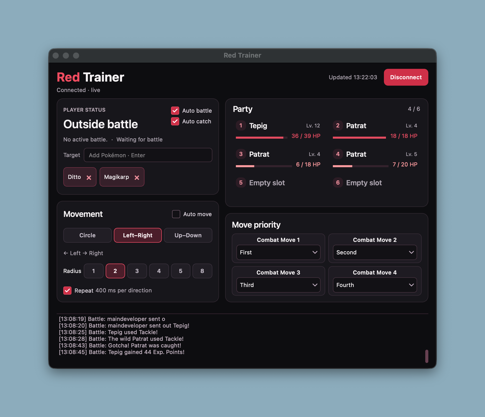

# RedTrainer by vnnsnnt

Catch Pokémon, farm payday, while you sleep or do other tasks on your computer

## Preview

## Features

- **Auto Battle** — Automatically engage in battles and execute moves without manual input.
- **Auto Catch** — Automatically battle and catch wild Pokémon.
- **Target Specific Pokémon** — Select which Pokémon to target, allowing you to focus on specific encounters.
- **Auto Movement** — Automate character movement to continuously encounter wild Pokémon.
- **Move Priority** — Customize the order in which moves are executed during battles.
- **Unfocused Window Support** — Run automation in the background while the game window is unfocused, allowing you to multitask.

## Demo
**[▶ Watch the Full Demo on YouTube](https://youtu.be/rC5x8f1HpvA)**

## Availability
Client available for a small one-time fee.

For access, contact **vnnsnnt@gmail.com**.

Developed by **[vnnsnnt](https://github.com/yzsvdu)**.
